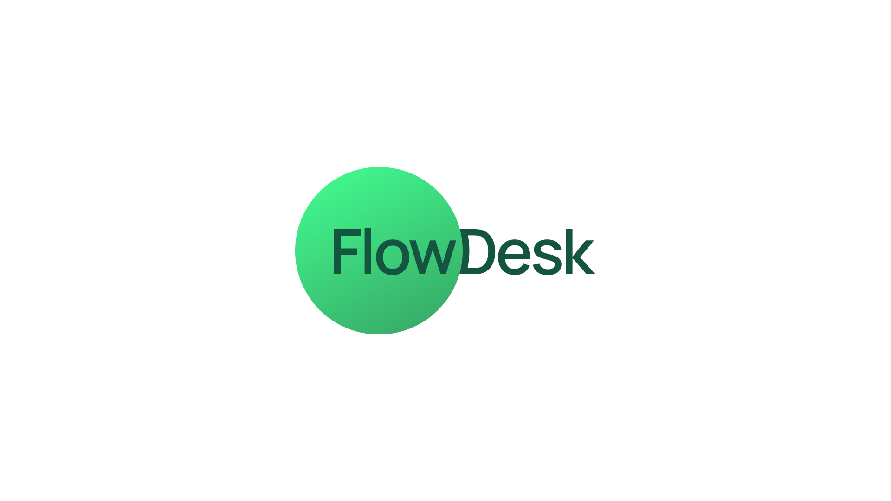

# FlowDesk



**Simple Incident Management for IT Service Operations**

[Live Demo](https://flowdesk-frontend-psi.vercel.app/) · [Latest Release](https://github.com/pauloarchanjo/flowdesk/releases/tag/v1.0.0)

FlowDesk is a lightweight IT Service Management application focused on the incident lifecycle.

The project was created to explore ITSM concepts, business rules, record lifecycle management, assignment logic and service desk workflows through a simple and maintainable application.

The current release is a frontend-first implementation built entirely with **HTML, CSS and Vanilla JavaScript**, using browser storage for persistence.

A REST API and persistent backend are planned for a future release.

---

## Overview

FlowDesk simulates the core workflow of an IT Service Desk without attempting to replicate a full enterprise ITSM platform.

The application focuses on a clear incident lifecycle:

```text
New
 ↓
Assigned
 ↓
In Progress
 ↓
Resolved
 ├── Closed
 └── Reopened
       ↓
   In Progress
```

Business rules control state transitions, assignments, priority calculation and incident resolution.

---

## Features

### Incident Management

- Create incidents
- View all incidents
- View incident details
- Edit incident classification
- Filter and search incidents
- Global incident search
- Dynamic incident numbering
- Persistent browser storage

### Priority Management

Priority is calculated automatically using:

- Impact
- Urgency

The application uses a priority matrix ranging from:

```text
P1 — Critical
P2 — High
P3 — Moderate
P4 — Low
```

### Assignment

Incidents support:

- Assignment Groups
- Assigned agents
- Automatic group suggestions based on category
- Assignment history

Current groups include:

- Service Desk
- Infrastructure
- Network
- Applications
- Security

### Incident Lifecycle

Controlled state transitions prevent invalid lifecycle changes.

Supported workflow:

```text
New
→ Assigned
→ In Progress
→ Resolved
→ Closed
```

Resolved incidents can also be reopened.

Closed incidents become read-only.

### Resolution Information

Resolving an incident requires:

- Resolution Code
- Resolution Notes
- Resolved By
- Resolved At

Resolution data is preserved when an incident is closed.

### Work Notes

Service desk agents can add internal work notes containing troubleshooting information and investigation updates.

Each work note automatically updates the incident timestamp and is added to the activity history.

### Activity History

FlowDesk maintains an audit trail containing events such as:

- Incident creation
- Assignment changes
- State transitions
- Field changes
- Work notes
- Resolution
- Reopening
- Closure

### Dynamic Dashboard

The dashboard automatically calculates:

- Open Incidents
- Critical / High Priority Incidents
- Incidents In Progress
- Incidents Resolved Today
- Recently Updated Incidents

Metrics are derived directly from the stored incident records.

### Global Search

The global search supports queries using:

- Incident number
- Title
- Caller
- Category
- Assignment Group
- Assigned agent
- Priority
- State

Multiple search terms can be combined.

Keyboard navigation is also supported.

### Feedback System

Reusable toast notifications provide feedback for actions such as:

- Incident creation
- Incident updates
- Assignment
- Work notes
- Resolution
- Reopening
- Closure

---

## Technology Stack

### Current Version

- HTML5
- CSS3
- Vanilla JavaScript
- ES Modules
- Web Storage API
- Native HTML Dialog API

No frontend framework is required.

### Planned Backend

A future release is planned with:

- Python
- FastAPI
- SQLAlchemy
- SQLite
- REST API
- Pytest

The current frontend architecture was structured so that browser storage can later be replaced by API-based persistence.

---

## Project Structure

```text
flowdesk/
├── frontend/
│   ├── index.html
│   │
│   ├── pages/
│   │   ├── incidents.html
│   │   ├── new-incident.html
│   │   └── incident-details.html
│   │
│   ├── css/
│   │   ├── variables.css
│   │   ├── base.css
│   │   ├── layout.css
│   │   ├── components.css
│   │   └── pages.css
│   │
│   └── js/
│       ├── app.js
│       │
│       ├── components/
│       │   ├── globalSearch.js
│       │   └── toast.js
│       │
│       ├── data/
│       │   └── incidents.js
│       │
│       ├── pages/
│       │   ├── dashboard.js
│       │   ├── incidents.js
│       │   ├── new-incident.js
│       │   └── incidentDetails.js
│       │
│       ├── services/
│       │   └── storageService.js
│       │
│       └── utils/
│           ├── assignment.js
│           ├── incidentLifecycle.js
│           └── priority.js
│
├── backend/
├── docs/
├── tests/
├── .gitignore
└── README.md
```

---

## Architecture

The frontend separates responsibilities into small modules:

```text
Pages
  ↓
UI / Components
  ↓
Business Rules
  ↓
Services
  ↓
Storage
```

Examples:

```text
incidentLifecycle.js
→ Incident state transition rules

priority.js
→ Impact / urgency priority matrix

assignment.js
→ Category and assignment rules

storageService.js
→ Incident persistence

toast.js
→ Global user feedback

globalSearch.js
→ Cross-application incident search
```

This separation makes it possible to replace the current storage layer with a REST API without rewriting the entire interface.

---

## Running Locally

Clone the repository:

```bash
git clone https://github.com/pauloarchanjo/flowdesk.git
cd flowdesk
```

Start a simple HTTP server:

```bash
python -m http.server 5500 -d frontend
```

Then open:

```text
http://localhost:5500
```

A local server is required because the application uses JavaScript ES Modules.

---

## Current Persistence

The current release uses the browser's `localStorage`.

Incident information remains available between page reloads within the same browser.

This implementation is intended for the frontend version of the project and will be replaced by backend persistence in a future release.

---

## Roadmap

### Frontend v1

- [x] Incident creation
- [x] Incident listing
- [x] Incident details
- [x] Incident editing
- [x] Priority calculation
- [x] Assignment rules
- [x] Incident lifecycle
- [x] Work notes
- [x] Activity history
- [x] Resolution information
- [x] Dynamic dashboard
- [x] Toast notifications
- [x] Global search

### Backend

- [ ] FastAPI REST API
- [ ] SQLAlchemy models
- [ ] SQLite persistence
- [ ] API validation
- [ ] Centralized business rules
- [ ] Error handling
- [ ] Replace localStorage with API services

### Quality

- [ ] Automated backend tests
- [ ] API documentation
- [ ] Improved frontend test coverage
- [ ] Deployment documentation

---

## Project Goals

FlowDesk was designed as a practical project for studying and demonstrating concepts commonly found in IT Service Management environments.

The project focuses especially on:

- Incident Management
- Record Lifecycle
- Assignment Logic
- Business Rules
- Priority Management
- Audit History
- Service Desk workflows
- REST-oriented architecture

The goal is not to reproduce an enterprise ITSM platform, but to implement its core concepts in a compact and understandable application.
